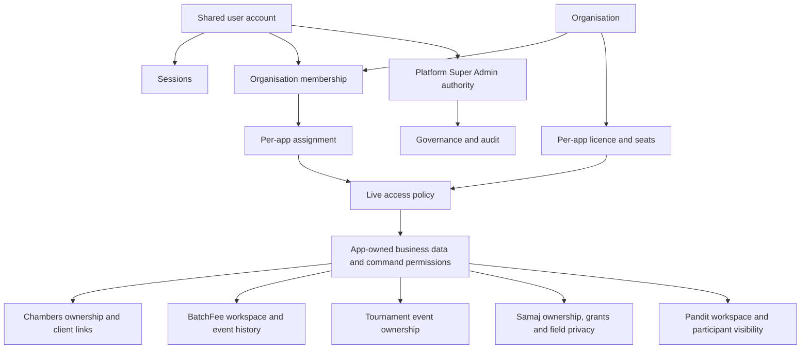

# Roles and database simplification review

Date: 9 November 2026 (IST). Status: first increment committed as `bbfce70` and
deployed as Worker `b7e0ddcb-f544-41c9-97fc-dde7ea1ebb3e`. Production audit was
read-only; no stored-role rewrites or business-data/schema changes were made.

## Recommendation

Keep one shared account, one workspace membership and explicit access to each
private app. Make the normal setup show the few roles a small team actually needs.
Keep specialist permissions available when required. Simplify the administration
experience and repeated implementation before changing persisted roles or tables.

The first increment centralises all 16 ordinary app/role assignment combinations in
`packages/auth/app-roles.mjs`. Administration validation, account navigation and
administration API metadata use this vocabulary. The role picker consumes the
server metadata, explains the selected role and filters staff/customer mismatches.
Existing incompatible assignments remain selectable for explicit revocation.
All stored role values, app command permissions, seat accounting, audit actions,
licence checks and record-level rules remain in place. Node preview remains
Chambers-only; its supported-app metadata now says this explicitly.

## What actually exists

There are several different meanings of “role”; they are not interchangeable.

| Layer | Stored values | What it controls |
|---|---|---|
| Legacy account | `users.role`: Owner, Advocate, Clerk | Default Node single-workspace compatibility. It is not the production organisation app role. New organisation accounts commonly have Clerk here. |
| Platform administration | `platform_super_admins` | Provisioning, licences and platform governance. No implicit private app record access. |
| Workspace membership | MasterAdmin, Administrator, Staff, Client | Which organisation a person belongs to and which seat pool they use. Only the designated active primary MasterAdmin manages that organisation; Administrator is not a second primary administrator. |
| App assignment | 16 roles across five apps | What role a person has in that named app and organisation, subject to membership/licence checks. |
| Community grant | Seven Samaj roles with geographical/family/self/all scopes | Record and field visibility within DIGITAL SAMAJ, in addition to its app assignment. Samaj SUPER_ADMIN is a community role, not a platform Super Admin. |
| Chambers client approval | Explicit client links plus Client entitlement | Read-only access to the approved client record set. Never inferred from names, email or membership. |

Chambers also stores a `Client` app assignment through its dedicated, separately
gated entitlement endpoint. That is an additional app/role combination, deliberately
excluded from the generic assignment picker; its approval/link workflow is intact.

The production snapshot has 12 active account rows: one legacy Owner, one Advocate
and ten Clerks. Memberships are three MasterAdmin, six Staff and two Client.
These are different counts because a global account need not have a membership
and an account can belong to more than one organisation. No Administrator
membership is currently present. Counts are a point-in-time observation, not a
reason to delete supported roles.

## App-by-app role decisions

| App | Current roles | Recommended normal setup | Preserve as additional options |
|---|---|---|---|
| Chambers | Owner, Advocate, Clerk | Existing three roles match actual chamber responsibilities. | Client portal stays a separate approval workflow. |
| BatchFee Lite | Owner, Manager, Collector, Viewer | Owner for a solo teacher; offer Collector when adding someone to record payments. | Manager and Viewer. Neither has a current production assignment. |
| Tournament Lite | Owner, Advocate | Owner for solo operation; describe Advocate as organiser access in the interface. | Preserve stored Advocate until an explicit compatible rename/migration is designed. |
| DIGITAL SAMAJ | Owner, Member, plus seven scoped community grant roles | Owner and Member at app entry; use task-oriented descriptions for community permissions. | Scoped community authority and field privacy must remain independent. |
| Pandit Booking | Owner, Dispatcher, Reviewer, Pandit, Customer | Show Owner as booking operator in explanatory copy; Pandit and Customer are distinct participants. | Dispatcher and Reviewer for delegated scheduling/approval. Neither has a current production assignment. |

Current assignment counts:

| App | Active assignments observed |
|---|---|
| Chambers | Owner 1, Advocate 1, Clerk 2 |
| BatchFee Lite | Owner 2, Collector 1 |
| Tournament Lite | Owner 1 |
| DIGITAL SAMAJ | Owner 1 |
| Pandit Booking | Owner 2, Pandit 2, Customer 2 |

### Important limits discovered

* A solo Pandit cannot currently hold both Owner and Pandit roles in the same
  organisation: `platform_app_assignments` has one row per organisation/user/app,
  and profile/availability mutations require Pandit. Prior conversational advice
  about one person doing both describes a possible future workflow, not a released
  capability. Supporting it needs an explicit capability/profile model and tests;
  silently letting Owner act as Pandit would change the approval boundary.
* Pandit profile approval explicitly requires a different reviewer. Keep that rule
  when considering a solo-provider setup; do not silently introduce self-approval.
* Collector and Viewer currently receive the whole BatchFee read projection,
  including student contact/financial information and expense records. Their write
  permissions differ. A narrower collector dashboard would require server-side
  projection changes; hiding fields in the interface alone is insufficient.
* Collector may record payments and sync generated dues. Manager also manages
  students, batches, manual charges, expenses and templates. Corrections such as
  reversing payments, waivers, profile settings and full backup/restore remain
  owner operations. Combining these roles would increase authority.
* Dispatcher and Reviewer are complementary, not duplicates: dispatch handles
  bookings and reports; review handles profile approval and review moderation.
  Owner has both. Reviewer does not receive full booking details by default.

## Database structure

Production contains **88 tables**: 86 application/infrastructure tables plus two
Cloudflare-managed tables. Replaying all twelve committed D1 migration files into
an isolated in-memory SQLite database yields the same 86 application table names,
columns, primary-key positions, foreign keys and indexes. This is a structural
comparison, not proof that every CHECK expression or business invariant is equal.
The live foreign-key check reports zero violations. The only current Samaj grant
is its community-level SUPER_ADMIN with ALL scope; this remains separate from
platform Super Admin authority. Both read-only D1 query batches report zero rows
written.

| Group | Tables | Purpose and simplification position |
|---|---:|---|
| Shared identity and compatibility | 6 | Users, sessions, legacy app access, preferences, settings and legacy audit. Keep compatibility separate from organisation authority. |
| Organisation administration | 10 | Organisations, memberships, licences, assignments, invitation/pending identity lifecycle, global authority, audit and migration/mapping metadata. Keep the access boundaries. |
| Chambers | 8 | Generic JSON records, document files, ownership, workspace settings, activity, snapshots and explicit client record links. |
| BatchFee Lite | 7 | Organisation workspace/event history plus older Node workspace/staff/history and legacy ownership/migration metadata. These are different runtime paths. |
| Tournament Lite | 3 | Event aggregates, ownership and migration metadata. |
| DIGITAL SAMAJ | 29 | Communities, persons/families/relationships, privacy grants, consent, import/review/audit, messages/attachments/preferences and events. Largest subsystem; not all 29 tables are access-control complexity. |
| Pandit Booking | 1 | Organisation-keyed bounded JSON workspace, containing services/providers/bookings/audit and a revision. |
| Satire Arena | 8 | Distinct vote tables with separate character constraints and composite keys. A generic replacement needs an explicit migration/public identifier compatibility plan. |
| Retired recovery | 8 | Five Times and three Fund Lens tables retained for existing data and full recovery. Retired endpoints remain removed. |
| D1 infrastructure | 6 | Optimistic revision/write guard, legacy object metadata/import tracking and document/community blobs. |
| Cloudflare system | 2 | `_cf_KV` and `d1_migrations`; managed infrastructure, not cleanup candidates. |

The non-retired native schema ownership sources reconstruct 51 tables before
optional organisation extensions. This is a source reconstruction, not a table
count of the existing `data/chambers.sqlite`. An attempted read-only open of that
existing file failed; no live Node data was read or changed. The audit tool now
requires an explicit `--local-database` to inspect an existing native database.



### Data that looks duplicated but serves a different purpose

* BatchFee JSON workspace is the current materialised state. Events are its
  append-only financial/recovery history. Removing either is not an ordinary
  duplicate-table cleanup.
* Chambers JSON records use common storage with views/indexes. Related record IDs
  inside JSON do not become SQL foreign keys; the validated business engine must
  retain relationship checks and atomic hearing/payment operations.
* Ownership tables bind older records/events/communities to organisations without
  rewriting their identities or erasing legacy recovery history.
* `edge_document_blobs` and `edge_samaj_blobs` support the deployed D1 storage
  boundary; legacy blob/object metadata remains part of existing recovery/import
  compatibility. Do not remove tables because the current app reads another path.
* Pandit's single JSON aggregate is physically simple but bounded at approximately
  850 KB and one revision per workspace. Splitting it into relational tables would
  be a scaling/concurrency project, not an immediate simplification.
* SQLite, D1 and SQL Server code is not interchangeable. Production uses D1;
  default Node uses SQLite. SQL Server is an optional code path and was not
  connected or validated against a live server in this review.
* Public apps also use transient or device-local storage. RozHisab uses
  IndexedDB by design; Focus, puzzles, Ritual checklists and other local tools have
  their own browser state. They do not need a server membership or a new role.

## Proposed sequence

1. **Implemented and deployed:** one role vocabulary, server-driven role picker,
   compatible member choices, role explanations, explicit revocation preservation,
   and a repeatable read-only database structure audit.
2. **Next interface increment:** standard setup with Owner and only the app's
   common team role; an explicit additional-roles disclosure for specialists.
   Retain assigned roles in edit/revoke flows even when they are uncommon. Explain
   workspace administration separately from app ownership. Stop suggesting that
   Administrator membership grants authority it does not have.
3. **Next product decisions:** decide whether a solo Pandit needs one account for
   operator/provider duties and how independent approval works; decide whether
   Collector/Viewer should receive narrower read projections. These affect access
   and require full API/record-visibility tests, not just labels.
4. **Later database work:** consider retiring dormant compatibility paths only
   after actual runtime use and complete recovery have been verified. Use additive
   migrations, restored-copy drills, ownership reconciliation and a tenant-safe
   rollback. No role rewrite, table drop, record purge or automatic data merge is
   part of this first increment.

## Evidence and verification

Read-only D1 queries exported schema definitions and aggregate role/scope counts;
no names, email addresses, credentials, tokens, documents or business records were
exported. Production schema and role metadata is under ignored `.publish/`.
The shareable structure snapshot contains only schema/aggregate metadata:
`docs/DATABASE_STRUCTURE_2026-11-09.json`.

Reproduce source/production schema comparison:

```powershell
node infrastructure/audit-database-structure.cjs --production-metadata .publish/roles-database-production-metadata.json --output .publish/roles-database-structure-audit.json
```

Verification: 27 focused role/administration/account checks, three administration
API checks and six actual Workers/D1 checks pass. All 27 administration Chrome
workflows pass; a final picker rerun also passes all twelve combinations of
320/390/768/1440px and Light/Dark/Deep Black. Mobile screenshot reviewed.
Full API/unit verification covers all 565 checks across the initial run (558
passed; seven Cloudflare checks blocked by a generated language-bundle filesystem
permission) and isolated rerun (all seven pass with appropriate filesystem access).
Exact production-configuration dry build passes with 650 public assets. Initial
browser runs exposed a Node administration response typo; fixed and verified.
Committed-source production release subsequently passed an isolated exact-config
dry build and deployment with --keep-vars. Live verification matches three
administration assets to that committed export and validates authenticated role
metadata for all five private apps, health 200/D1 and private access denials.
Authentication/organisation/D1/rate-limit configuration and business data remain
intact. The remaining recommendations are analysis, not deployed permission or
schema changes. Unrelated untracked security/performance reports remain excluded.
Release evidence: `.publish/roles-release-{dryrun,deploy,live}.log` and
`.publish/roles-release-live.json`.

Evidence under `.publish/`: `role-simplification-focused.log`,
`role-simplification-api.log`, `role-simplification-d1.log`,
`role-simplification-admin-final.log`, `role-simplification-layout.log`,
`role-simplification-mobile.png`, `role-simplification-full.log`,
`role-simplification-cloudflare-rerun.log`, `role-simplification-dryrun.log`,
`roles-database-production-metadata.json`,
`roles-database-integrity-metadata.json`, `roles-database-structure-audit.json`.

## Complete production table inventory

The table below lists every production table, its columns, primary key, declared
foreign keys and number of indexes (including SQLite-generated unique indexes).
Detailed SQL/column/index metadata is in the accompanying JSON snapshot. JSON
fields also contain validated business relationships not represented by SQL FKs.

| Table | Owner | Columns | Primary key | Foreign keys | Indexes |
|---|---|---|---|---|---:|
| `_cf_KV` | D1 system | key, value | key | � | 1 |
| `app_access` | Shared identity and compatibility | userId, appId | userId, appId | userId ? users.id | 1 |
| `arena_additions_votes` | Satire Arena | voter, character, round, reaction, updated_at | voter, character, round | � | 2 |
| `arena_anchors_votes` | Satire Arena | voter, character, round, reaction, updated_at | voter, character, round | � | 2 |
| `arena_boardroom_votes` | Satire Arena | voter, character, round, reaction, updated_at | voter, character, round | � | 2 |
| `arena_cast_votes` | Satire Arena | voter, character, round, reaction, updated_at | voter, character, round | � | 2 |
| `arena_expanded_votes` | Satire Arena | voter, character, round, reaction, updated_at | voter, character, round | � | 2 |
| `arena_speakers_votes` | Satire Arena | voter, character, round, reaction, updated_at | voter, character, round | � | 2 |
| `arena_spotlight_votes` | Satire Arena | voter, character, round, reaction, updated_at | voter, character, round | � | 2 |
| `arena_votes` | Satire Arena | voter, character, round, reaction, updated_at | voter, character, round | � | 2 |
| `audit` | Shared identity and compatibility | id, at, actor, action, kind, recordId, label | id | � | 0 |
| `batchfee_events` | BatchFee Lite | id, at, actor, action, data | id | � | 0 |
| `batchfee_legacy_ownership` | BatchFee Lite | legacyWorkspaceId, organisationId | legacyWorkspaceId | organisationId ? platform_organisations.id | 1 |
| `batchfee_migrations` | BatchFee Lite | version | version | � | 0 |
| `batchfee_organisation_events` | BatchFee Lite | id, organisationId, at, actor, action, data | id | organisationId ? batchfee_organisation_workspaces.organisationId | 1 |
| `batchfee_organisation_workspaces` | BatchFee Lite | organisationId, revision, data | organisationId | organisationId ? platform_organisations.id | 1 |
| `batchfee_staff` | BatchFee Lite | user_id, role | user_id | user_id ? users.id | 1 |
| `batchfee_workspace` | BatchFee Lite | id, revision, data | id | � | 0 |
| `chambers_activity` | Chambers | id, organisationId, actorUserId, actor, action, kind, recordId, label, at | id | actorUserId ? users.id; organisationId ? platform_organisations.id | 1 |
| `chambers_client_access` | Chambers | organisationId, userId, kind, clientId, status, createdAt, updatedAt | organisationId, userId, clientId | organisationId ? chambers_record_ownership.organisationId; kind ? chambers_record_ownership.kind; clientId ? chambers_record_ownership.recordId; organisationId ? platform_memberships.organisationId; userId ? platform_memberships.userId | 1 |
| `chambers_file_ownership` | Chambers | fileId, organisationId | fileId | organisationId ? platform_organisations.id; fileId ? files.id | 2 |
| `chambers_record_ownership` | Chambers | kind, recordId, organisationId | kind, recordId | kind ? records.kind; recordId ? records.id; organisationId ? platform_organisations.id | 3 |
| `chambers_snapshots` | Chambers | id, organisationId, bucket, at, data | id | organisationId ? platform_organisations.id | 2 |
| `chambers_workspace_settings` | Chambers | organisationId, data | organisationId | organisationId ? platform_organisations.id | 1 |
| `d1_migrations` | D1 system | id, name, applied_at | id | � | 1 |
| `edge_document_blobs` | D1 infrastructure | id, name, mime, size, sha256, content, created_at | id | id ? files.id | 1 |
| `edge_imports` | D1 infrastructure | id, manifest_hash, completed_at | id | � | 1 |
| `edge_objects` | D1 infrastructure | scope, id, object_key, name, mime, size, sha256, created_at | scope, id | � | 2 |
| `edge_revision` | D1 infrastructure | id, revision | id | � | 0 |
| `edge_samaj_blobs` | D1 infrastructure | id, file_id, attachment_id, name, mime, size, sha256, content, created_at | id | attachment_id ? samaj_message_attachments.id; file_id ? samaj_files.id | 1 |
| `edge_write_guard` | D1 infrastructure | id, valid | id | � | 1 |
| `files` | Chambers | id, name, mime, content | id | � | 1 |
| `fund_lens_migrations` | Retired recovery | version, appliedAt | version | � | 0 |
| `fund_lens_portfolios` | Retired recovery | userId, revision | userId | userId ? users.id | 1 |
| `fund_lens_transactions` | Retired recovery | id, userId, schemeCode, schemeName, date, type, units, amount, reference, fingerprint | id | userId ? users.id | 3 |
| `news_editions` | Retired recovery | date, name, author, cutoff, publishedAt, satireTitle, satireBody, satireStory, model, promptVersion | date | � | 1 |
| `news_fetch_budget` | Retired recovery | day, requests | day | � | 1 |
| `news_migrations` | Retired recovery | version, appliedAt | version | � | 0 |
| `news_runs` | Retired recovery | date, cutoff, state, sourceJson, attempts, leaseToken, leaseUntil, error, createdAt, updatedAt | date | � | 1 |
| `news_stories` | Retired recovery | editionDate, position, title, brief, source, url, publishedAt | editionDate, position | editionDate ? news_editions.date | 2 |
| `pandit_booking_workspaces` | Pandit Booking | organisationId, version, data | organisationId | � | 1 |
| `platform_app_assignments` | Organisation administration | organisationId, userId, appId, role, status | organisationId, userId, appId | organisationId ? platform_app_licences.organisationId; appId ? platform_app_licences.appId; organisationId ? platform_memberships.organisationId; userId ? platform_memberships.userId | 1 |
| `platform_app_licences` | Organisation administration | organisationId, appId, status, startsAt, endsAt, readOnlyUntil, staffLimit, clientLimit, version | organisationId, appId | organisationId ? platform_organisations.id | 1 |
| `platform_legacy_workspaces` | Organisation administration | appId, organisationId, mappedAt, snapshotHash | appId | organisationId ? platform_organisations.id | 3 |
| `platform_memberships` | Organisation administration | organisationId, userId, role, status, createdAt | organisationId, userId | userId ? users.id; organisationId ? platform_organisations.id | 4 |
| `platform_organisation_audit` | Organisation administration | id, organisationId, actorUserId, action, at, details | id | actorUserId ? users.id; organisationId ? platform_organisations.id | 0 |
| `platform_organisation_invitations` | Organisation administration | id, organisationId, userId, email, tokenHash, expiresAt, consumedAt, revokedAt, createdAt | id | organisationId ? platform_memberships.organisationId; userId ? platform_memberships.userId | 3 |
| `platform_organisation_migrations` | Organisation administration | id, checksum | id | � | 1 |
| `platform_organisations` | Organisation administration | id, name, type, timezone, status, masterAdminUserId, masterAdminRole, staffLimit, clientLimit, version, createdAt | id | id ? platform_memberships.organisationId; masterAdminUserId ? platform_memberships.userId; masterAdminRole ? platform_memberships.role; masterAdminUserId ? users.id | 1 |
| `platform_pending_identities` | Organisation administration | userId, createdAt, activatedAt | userId | userId ? users.id | 1 |
| `platform_preferences` | Shared identity and compatibility | userId, data | userId | userId ? users.id | 1 |
| `platform_super_admins` | Organisation administration | userId, active, createdAt | userId | userId ? users.id | 1 |
| `records` | Chambers | kind, id, data | kind, id | � | 4 |
| `samaj_announcements` | DIGITAL SAMAJ | id, samaj_id, title, body, actor, created_at | id | actor ? users.id; samaj_id ? samaj_communities.id | 1 |
| `samaj_audit` | DIGITAL SAMAJ | id, samaj_id, actor, action, entity_id, old_value, new_value, at | id | actor ? users.id; samaj_id ? samaj_communities.id | 1 |
| `samaj_blocks` | DIGITAL SAMAJ | user_id, blocked_id | user_id, blocked_id | blocked_id ? users.id; user_id ? users.id | 1 |
| `samaj_communities` | DIGITAL SAMAJ | id, name, created_at | id | � | 1 |
| `samaj_consent` | DIGITAL SAMAJ | id, family_id, user_id, version, given_at | id | user_id ? users.id; family_id ? samaj_families.id | 1 |
| `samaj_conversations` | DIGITAL SAMAJ | id, samaj_id, sender, receiver, reason, status, created_at | id | receiver ? users.id; sender ? users.id; samaj_id ? samaj_communities.id | 3 |
| `samaj_drafts` | DIGITAL SAMAJ | id, samaj_id, user_id, revision, step, data, submitted_family_id, updated_at | id | submitted_family_id ? samaj_families.id; user_id ? users.id; samaj_id ? samaj_communities.id | 2 |
| `samaj_duplicate_decisions` | DIGITAL SAMAJ | person_id, related_id, decision, actor, at | person_id, related_id | actor ? users.id; related_id ? samaj_persons.id; person_id ? samaj_persons.id | 1 |
| `samaj_event_rsvps` | DIGITAL SAMAJ | event_id, user_id, response | event_id, user_id | user_id ? users.id; event_id ? samaj_events.id | 1 |
| `samaj_events` | DIGITAL SAMAJ | id, samaj_id, title, starts_at, location, description, family_id, created_by, cancelled | id | created_by ? users.id; family_id ? samaj_families.id; samaj_id ? samaj_communities.id | 2 |
| `samaj_families` | DIGITAL SAMAJ | id, samaj_id, code, head_id, status, revision, data, privacy, created_by, created_at, updated_at | id | created_by ? users.id; head_id ? samaj_persons.id; samaj_id ? samaj_communities.id | 3 |
| `samaj_files` | DIGITAL SAMAJ | id, samaj_id, person_id, family_id, name, mime, content, created_by, created_at | id | created_by ? users.id; family_id ? samaj_families.id; person_id ? samaj_persons.id; samaj_id ? samaj_communities.id | 1 |
| `samaj_grants` | DIGITAL SAMAJ | id, user_id, samaj_id, role_id, scope, scope_value, created_at | id | role_id ? samaj_roles.id; samaj_id ? samaj_communities.id; user_id ? users.id | 3 |
| `samaj_import_jobs` | DIGITAL SAMAJ | id, samaj_id, created_by, status, data, created_at | id | created_by ? users.id; samaj_id ? samaj_communities.id | 1 |
| `samaj_memberships` | DIGITAL SAMAJ | id, person_id, family_id, type, is_primary, start_date, end_date | id | family_id ? samaj_families.id; person_id ? samaj_persons.id | 4 |
| `samaj_message_attachments` | DIGITAL SAMAJ | id, message_id, name, mime, content | id | message_id ? samaj_messages.id | 1 |
| `samaj_message_preferences` | DIGITAL SAMAJ | user_id, samaj_id, visibility | user_id, samaj_id | samaj_id ? samaj_communities.id; user_id ? users.id | 1 |
| `samaj_message_reports` | DIGITAL SAMAJ | id, message_id, reporter, reason, status, created_at | id | reporter ? users.id; message_id ? samaj_messages.id | 1 |
| `samaj_messages` | DIGITAL SAMAJ | id, conversation_id, sender, body, created_at | id | sender ? users.id; conversation_id ? samaj_conversations.id | 2 |
| `samaj_migrations` | DIGITAL SAMAJ | version | version | � | 0 |
| `samaj_organisation_ownership` | DIGITAL SAMAJ | samajId, organisationId | samajId | organisationId ? platform_organisations.id; samajId ? samaj_communities.id | 2 |
| `samaj_participants` | DIGITAL SAMAJ | conversation_id, user_id, read_at, muted | conversation_id, user_id | user_id ? users.id; conversation_id ? samaj_conversations.id | 1 |
| `samaj_permissions` | DIGITAL SAMAJ | id | id | � | 1 |
| `samaj_persons` | DIGITAL SAMAJ | id, samaj_id, code, status, revision, data, privacy, created_by, created_at, updated_at, merged_into | id | merged_into ? samaj_persons.id; created_by ? users.id; samaj_id ? samaj_communities.id | 3 |
| `samaj_relationships` | DIGITAL SAMAJ | id, person_id, related_id, type, status, end_date, created_by | id | created_by ? users.id; related_id ? samaj_persons.id; person_id ? samaj_persons.id | 3 |
| `samaj_reviews` | DIGITAL SAMAJ | id, samaj_id, kind, entity_id, requested_by, status, old_value, new_value, created_at, reviewed_by, reviewed_at, reason | id | reviewed_by ? users.id; requested_by ? users.id; samaj_id ? samaj_communities.id | 3 |
| `samaj_role_permissions` | DIGITAL SAMAJ | role_id, permission | role_id, permission | permission ? samaj_permissions.id; role_id ? samaj_roles.id | 1 |
| `samaj_roles` | DIGITAL SAMAJ | id | id | � | 1 |
| `samaj_user_person` | DIGITAL SAMAJ | user_id, samaj_id, person_id | user_id, samaj_id | person_id ? samaj_persons.id; samaj_id ? samaj_communities.id; user_id ? users.id | 2 |
| `sessions` | Shared identity and compatibility | token, userId, expires | token | userId ? users.id | 3 |
| `settings` | Shared identity and compatibility | id, data | id | � | 1 |
| `tournament_lite_events` | Tournament Lite | id, owner, revision, public_token, data | id | � | 2 |
| `tournament_lite_migrations` | Tournament Lite | version | version | � | 0 |
| `tournament_lite_ownership` | Tournament Lite | eventId, organisationId | eventId | organisationId ? platform_organisations.id; eventId ? tournament_lite_events.id | 2 |
| `users` | Shared identity and compatibility | id, name, email, role, password, active | id | � | 2 |
